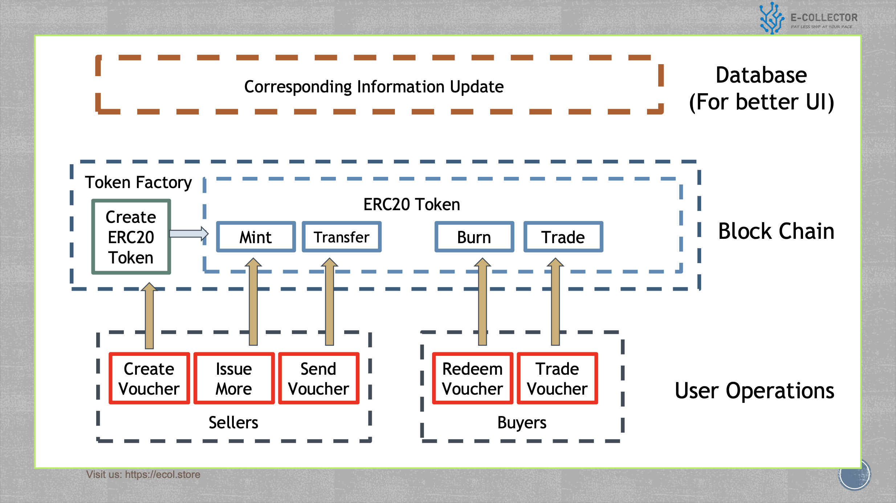

<a name="readme-top"></a>

<div align="center">
  <a href="public/images/Logo.png">
    
  </a>

  <br />

  # E-Collector

  ### Decentralized Product Voucher Marketplace

  [](https://react.dev/)
  [](https://typescriptlang.org/)
  [](https://soliditylang.org/)
  [](https://firebase.google.com/)
  [](https://vitejs.dev/)
  [](LICENSE)

  *A full-stack Web3 e-commerce platform where merchants issue blockchain-backed product voucher tokens and consumers trade, redeem, and track orders -- all powered by smart contract escrow and real-time Firebase.*

  **[Live Demo](https://ecol.store)** | **[Smart Contracts](https://github.com/MichaelYang-lyx/Web3_contract)**

</div>

---

## What is E-Collector?

E-Collector reimagines e-commerce with **blockchain-backed product vouchers**. Instead of traditional shopping carts, merchants issue **ERC20 tokens** representing real products. Consumers purchase, trade, and redeem these tokens for physical goods -- with every transaction secured by on-chain escrow.

> Not a coupon. Not a gift card. A **tradeable digital asset** backed by real products.

### Key Features

| Feature | Description |
|---------|-------------|
| **Token-Based Commerce** | Merchants mint ERC20 tokens per product; consumers hold, trade, or redeem |
| **Escrow Marketplace** | Trustless trading via smart contract escrow with dispute arbitration |
| **Dual-Mode Interface** | Seamless seller/buyer toggle with role-specific dashboards |
| **Real-Time Chat** | Firebase-powered instant messaging with image support |
| **Analytics Dashboard** | KPI cards, product breakdown, dispute rate tracking |
| **MetaMask Auth** | Wallet-based identity linking on-chain address to user profile |
| **NFT Certificates** | ERC721 product NFTs with ERC2981 royalties and on-chain provenance |

## Architecture

```
+------------------------------------------------------------------+
|                        Browser Client                             |
|  +-------------+   +------------------+   +-------------------+  |
|  |  MetaMask   |   |  React + TS DApp |   |  Firebase SDK     |  |
|  |  (Signing)  |   |  (Vite + MUI)    |   |  (Auth/Firestore) |  |
|  +------+------+   +--------+---------+   +---------+---------+  |
+---------|-------------------|------------------------|-----------+
          |    ethers.js      |                        |
          v                   v                        v
  +----------------+   +----------+            +-------------+
  | EVM Blockchain |   | Firebase |            | Firestore   |
  | TokenFactory   |   | Auth     |            | (Real-time) |
  | Token (x N)    |   +----------+            +-------------+
  | Marketplace    |
  | ProductNFT     |
  +----------------+
```

### General Structure



## Tech Stack

<table>
<tr><td><b>Frontend</b></td><td>React 18, TypeScript, Vite 4, Material UI 5, SCSS</td></tr>
<tr><td><b>Blockchain</b></td><td>ethers.js v5, MetaMask SDK, Solidity 0.8.20, OpenZeppelin v5</td></tr>
<tr><td><b>Backend</b></td><td>Firebase Auth, Cloud Firestore (real-time), Firebase Storage</td></tr>
<tr><td><b>Smart Contracts</b></td><td>Token (ERC20+Permit), TokenFactory, Marketplace (Escrow), ProductNFT (ERC721+ERC2981)</td></tr>
<tr><td><b>Testing</b></td><td>Hardhat, Chai, 25+ test cases</td></tr>
<tr><td><b>Deployment</b></td><td>Axiomesh Chain (prod), Sepolia & Polygon Amoy (test)</td></tr>
</table>

## Smart Contract Highlights

| Contract | What it Does |
|----------|-------------|
| **Token** | ERC20 + EIP-2612 Permit (gasless approvals) + RBAC + Pausable + supply cap |
| **TokenFactory** | Permissionless deployer with on-chain registry, batch queries, deploy fee |
| **Marketplace** | Escrow-based trading: list -> buy -> ship -> confirm, with dispute arbitration and 2.5% platform fee |
| **ProductNFT** | ERC721 + ERC2981 royalties + state machine (Minted->Delivered) + trade count provenance |

> Full contract details: [Web3_contract repo](https://github.com/MichaelYang-lyx/Web3_contract)

## Frontend Highlights

### Custom React Hooks
```typescript
useWallet()          // Connect/disconnect MetaMask, listen for chain changes
useContract<T>()     // Generic typed contract instantiation
useTokenFactory()    // Token creation with event parsing
useTokenBalance()    // Real-time balance queries with refresh
useFirestoreQuery<T>() // Generic real-time Firestore subscriptions
```

### Seller Analytics Dashboard
- KPI cards: total products, orders, completion rate, active listings
- Per-product sales breakdown table
- Dispute rate alerts

### Real-Time Features
- Firestore `onSnapshot` listeners for instant UI updates
- Passive operation notifications when counterparty acts
- Live chat with text and image messages

## Quick Start

```bash
# Clone
git clone https://github.com/MichaelYang-lyx/E_Collector.git
cd E_Collector

# Install dependencies
npm install

# Start dev server
npm run dev
```

### Prerequisites
1. **MetaMask** -- [Install](https://metamask.io/download/)
2. **Axiomesh Network** -- [Add to MetaMask](https://docs.axiomesh.io/en/documentation/getting-started/resources/resources)
3. **Test tokens** -- [Axiomesh Faucet](https://faucet.aries.axiomesh.io/)

## User Flow

```
Register (MetaMask) --> Connect Wallet --> Choose Mode
                                              |
                         +--------------------+--------------------+
                         |                                         |
                    SELLER MODE                              BUYER MODE
                    - Create products (mint tokens)          - View vouchers
                    - Issue more tokens                      - Redeem tokens
                    - Send tokens to buyers                  - Track orders
                    - View analytics dashboard               - Real-time chat
                    - Manage orders & shipping
```

## Contact

**Yibo Yang** -- MSc Big Data Technology, HKUST -- yyanggh@connect.ust.hk

Project Link: [https://ecol.store](https://ecol.store)

<p align="right">(<a href="#readme-top">back to top</a>)</p>

## License

MIT License -- Copyright (c) 2023 Yibo Yang, Sichen Wang
